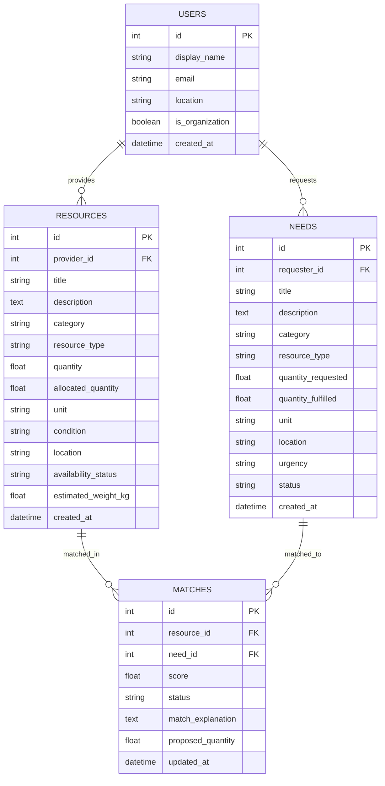

# ReSpark — Rediscover the Value Around You

> **"Every unused resource can create a new opportunity."**  
> An intelligent community resource-sharing platform that connects individuals, students, families, and local organizations who have surplus items or skills with people who urgently need them.

[](https://fastapi.tiangolo.com)
[](https://react.dev)
[](https://tailwindcss.com)
[](https://sqlite.org)
[](LICENSE)

---

## 1. Project Overview

**ReSpark** solves a pervasive modern inefficiency: while countless textbooks sit untouched on shelves, laptops gather dust in drawers, furniture remains stored away, and professionals have spare time to mentor, community members and under-resourced students nearby often lack those exact essentials.

ReSpark provides a **real, fully functional, free-and-local** hackathon prototype that:
- Connects community donors and requesters across **6 core categories** (Textbooks, Electronics, Furniture, Stationery, Skills, and Volunteer Time).
- Powers an **explainable 5-stage AI matching engine** that pairs resources with community needs using TF-IDF text similarity and multi-factor compatibility scoring.
- Enforces **strict transactional state machines** preventing duplicate matches and over-allocation of quantities.
- Derives **real-time dashboard analytics and environmental metrics** (landfill waste diverted in kg, embodied carbon avoided in kg CO2e) directly from verified database records.

---

## 2. Key Features

- **Compelling Landing Page**: Dynamic live impact counters, category explorer, 3-step explanation, and instant demo guidance.
- **Real-Time Analytics Dashboard**: Real SQLite database counts for available resources, open needs, in-flight matches, completed exchanges, and interactive Recharts visualizations (Listing distributions, pipeline progress, 7-day timeline).
- **Searchable & Filterable Catalog**: Instant text search and multi-facet filtering by category, condition, location, and availability status.
- **Resource Sharing Form**: Comprehensive submission form supporting physical assets, skills, and volunteer time with automatic unit assignment, condition tags, and estimated item weight for environmental impact accounting.
- **Community Need Posting**: Request portal capturing title, category, quantity, location, deadline, and urgency levels (Low, Medium, High, Critical).
- **Flagship Smart Matches**: Ranked recommendations displaying normalized match scores (0–100), visual compatibility badges, and full **natural language explanations** (breakdown across semantics, category, quantity, location, and urgency).
- **Exchange Pipeline (Kanban & Table)**: Interactive match lifecycle tracking (`suggested` &rarr; `interest_expressed` &rarr; `accepted` &rarr; `completed` / `rejected` / `cancelled`) with atomic quantity reservations.
- **My Listings Management**: Multi-tab view of owned resources and requested needs with status indicators and deactivation safeguards.
- **Transparent Impact Accounting**: Verified metrics derived from completed transactions with explicit documented scientific assumptions (EPA product weights and embodied carbon calculations).
- **Demo Identity Switcher**: Switch between realistic personas (students, donors, community youth centers) directly from the header without login friction.

---

## 3. Technology Stack

### Frontend
- **React 18** with **TypeScript** and **Vite**
- **Tailwind CSS v3** with custom Emerald/Teal brand palette and Warm Amber accent
- **Lucide React** for modern UI iconography
- **Recharts** for responsive, animated analytics charts
- **React Router v6** for client-side routing

### Backend
- **Python 3.11+**
- **FastAPI** for high-performance REST APIs with automatic OpenAPI/Swagger documentation
- **SQLAlchemy 2.0** ORM for structured database operations and atomic transactions
- **SQLite 3** for local zero-configuration persistence
- **scikit-learn** for TF-IDF vectorization and Cosine Similarity (with token-overlap fallback)
- **Pydantic v2** for robust request/response validation and error schemas

### Testing & Quality Assurance
- **Pytest** for backend unit, integration, and algorithmic test suites
- **HTTPX** for API client testing
- **TypeScript & Vite Compiler** for production build type checking

---

## 4. Architecture & System Design

```
ReSpark/
├── backend/
│   ├── app/
│   │   ├── main.py              # FastAPI app lifecycle, CORS, table creation & seed
│   │   ├── core/
│   │   │   └── config.py        # Settings, CORS origins, SQLite URL
│   │   ├── db/
│   │   │   ├── session.py       # Engine, SessionLocal, Base, get_db dependency
│   │   │   └── seed.py          # Idempotent realistic seed data
│   │   ├── models/              # SQLAlchemy ORM models (User, Resource, Need, Match)
│   │   ├── schemas/             # Pydantic v2 validation models
│   │   ├── services/
│   │   │   ├── matching_engine.py  # 5-stage explainable AI matching engine
│   │   │   ├── match_service.py    # State machine & transactional inventory updates
│   │   │   └── stats_service.py    # Real-time dashboard & impact analytics
│   │   └── api/
│   │       ├── api_router.py    # Consolidated API routes
│   │       └── endpoints/       # Resources, Needs, Matches, Stats, Users, Health
│   ├── tests/                   # Pytest suite (16 comprehensive tests)
│   ├── test_workflow.py         # 10-step E2E verification test script
│   └── requirements.txt
├── frontend/
│   ├── src/
│   │   ├── components/          # Badges, ResourceCard, StatCard, Feedback, ConfirmDialog
│   │   ├── hooks/               # useDemoUser, useToast
│   │   ├── layouts/             # MainLayout with header, account switcher, footer
│   │   ├── pages/               # Landing, Dashboard, Explore, Share, Need, Matches, Pipeline, MyListings, Impact
│   │   ├── services/            # Centralized API client (api.ts)
│   │   ├── types/               # TypeScript interfaces and enum definitions
│   │   └── utils/               # Formatters and date utilities
│   ├── package.json
│   └── tailwind.config.js
├── start-backend.ps1            # Windows one-click backend startup
├── start-frontend.ps1           # Windows one-click frontend startup
├── run-tests.ps1                # One-click test runner
├── run-demo-workflow.ps1        # One-click E2E workflow runner
└── README.md
```

---

## 5. Explainable AI Matching Engine

ReSpark's matching engine is an **explainable, multi-stage hybrid system** that avoids black-box predictions and never invents scores:

```
[Available Resources] + [Open Needs]
           │
           ▼
Stage 1: Hard Constraint Filtering
  ├── Resource must be AVAILABLE (remaining quantity > 0)
  ├── Need must be OPEN (remaining requested > 0)
  ├── Compatible Category & Resource Type
  ├── Exclude Self-Matching (provider != requester)
  └── Prevent duplicate active match pairs
           │
           ▼
Stage 2: Text Similarity (TF-IDF + Cosine Similarity)
  ├── Title tokens weighted 2x, description 1x
  ├── Scikit-learn TfidfVectorizer (English stop-words, 1-2 ngrams)
  └── Jaccard token-overlap fallback for resilient execution
           │
           ▼
Stage 3: Weighted Multi-Factor Compatibility Scoring (0–100)
  ├── Text Semantic Similarity:   35%
  ├── Category & Type Match:      25%
  ├── Quantity Coverage Ratio:    15%
  ├── Location Proximity:         15%
  └── Need Urgency & Readiness:   10%
           │
           ▼
Stage 4: Natural Language Explanation Generation
  ├── "Strong semantic alignment (84% similarity) between listings"
  ├── "Full quantity coverage: available 3 covers requested 2"
  ├── "Same neighborhood or community area: 'University Campus'"
  └── "Priority boost: Need is marked 'HIGH' urgency"
           │
           ▼
Stage 5: Transactional Inventory Reservation
  └── Prevents over-allocation when matches are accepted or completed
```

---

## 6. Database Design



---

## 7. Windows Installation & Setup Guide

### Prerequisites
- **Python 3.10+** (Python 3.11 installed and verified)
- **Node.js 18+** and **npm** (Node v24.18 and npm 11.16 installed and verified)
- **PowerShell** on Windows

---

### Step 1: Clone or Navigate to the Workspace
```powershell
cd C:\Users\venka\Documents\ReSpark
```

---

### Step 2: Setup Backend Virtual Environment & Dependencies
```powershell
cd backend
python -m venv venv
.\venv\Scripts\pip.exe install -r requirements.txt
cd ..
```

---

### Step 3: Install Frontend Dependencies
```powershell
cd frontend
npm install
cd ..
```

---

## 8. Running the Application

### Option A: Using Convenience PowerShell Scripts (Recommended)

1. **Start the Backend Server (Terminal 1):**
   ```powershell
   .\start-backend.ps1
   ```
   *Runs FastAPI on `http://127.0.0.1:8000` with automatic table initialization and idempotent seed data.*

2. **Start the Frontend Dev Server (Terminal 2):**
   ```powershell
   .\start-frontend.ps1
   ```
   *Runs Vite on `http://127.0.0.1:5173`.*

---

### Option B: Manual Startup Commands

1. **Backend:**
   ```powershell
   cd C:\Users\venka\Documents\ReSpark\backend
   .\venv\Scripts\python.exe -m uvicorn app.main:app --host 127.0.0.1 --port 8000 --reload
   ```

2. **Frontend:**
   ```powershell
   cd C:\Users\venka\Documents\ReSpark\frontend
   npm run dev -- --host 127.0.0.1 --port 5173
   ```

---

## 9. Key Local URLs

| Interface | URL | Description |
|:---|:---|:---|
| **Frontend Web App** | [http://127.0.0.1:5173](http://127.0.0.1:5173) | Main user interface (Landing, Dashboard, Smart Matches, etc.) |
| **Interactive API Docs** | [http://127.0.0.1:8000/docs](http://127.0.0.1:8000/docs) | Swagger UI for exploring and testing all REST endpoints |
| **ReDoc API Reference** | [http://127.0.0.1:8000/redoc](http://127.0.0.1:8000/redoc) | Alternative OpenAPI documentation format |
| **Backend Health Check** | [http://127.0.0.1:8000/api/v1/health](http://127.0.0.1:8000/api/v1/health) | API health check and version metadata |

---

## 10. Automated Testing & Verification

### Running Backend Unit & Integration Tests
Execute all 16 tests with Pytest:
```powershell
.\run-tests.ps1
```
*Or directly in the backend folder:*
```powershell
cd backend
.\venv\Scripts\python.exe -m pytest tests -v
```

**Test Coverage:**
- `test_health.py`: Health endpoint and routing prefix compatibility.
- `test_resources_and_needs.py`: CRUD operations, search keyword queries, category filtering, and Pydantic validation errors.
- `test_matching_engine.py`: Hard constraint filtering (closed needs, inactive listings, self-matching, zero inventory), multi-factor scoring normalization (0–100), and natural language explainability generation.
- `test_match_lifecycle.py`: State machine happy path, invalid state transition rejection (HTTP 400), inventory reservation, and over-allocation prevention (HTTP 409).
- `test_stats_and_impact.py`: Dashboard KPIs, community impact calculations, and dynamic real-time recalculation after match completions.

### Running Frontend Production Build & Typecheck
```powershell
cd frontend
npm run build
```
*Compiles TypeScript without warnings and generates the production bundle in `frontend/dist`.*

---

## 11. 10-Step Hackathon Demonstration Workflow

You can verify the entire end-to-end lifecycle by running our automated verification script:
```powershell
.\run-demo-workflow.ps1
```

Or execute it manually in the browser at [http://127.0.0.1:5173](http://127.0.0.1:5173):

1. **Open Dashboard (`/dashboard`)**: Observe baseline metrics (e.g. 8 resources, 5 open needs, 1 completed match, 4.2 kg waste avoided).
2. **Explore Resources (`/explore`)**: Filter by *Textbooks* or search for *"Algorithms"*. Click *View Details* to inspect conditions and pickup instructions.
3. **Share a Resource (`/share`)**: Post a new textbook (e.g., *"Discrete Mathematics (Rosen 8th Ed)"*, 1 book, 2.1 kg) as Elena Rostova.
4. **Post a Matching Need (`/post-need`)**: Switch identity or post as Priya Patel requesting *"Discrete Mathematics Textbook"* with *High* urgency.
5. **Generate Recommendations (`/matches`)**: Click **"Refresh Recommendations"**. The AI matching engine evaluates candidates and ranks the new pairing.
6. **Review Match Score & Evidence**: Expand the match card to see the multi-factor breakdown: ~73% composite score, 100% category match, 100% quantity coverage, same campus neighborhood.
7. **Express Interest & Accept Match**: Click **"Express Interest"**, then **"Accept Match"**. Notice that the resource is automatically marked as **Reserved** and 1 unit is locked.
8. **Complete Handoff**: Click **"Complete Handoff"** and confirm. The match status updates to **Completed**, the resource transitions to **Completed**, and the need is marked **Fulfilled**.
9. **Verify Real-Time Analytics (`/dashboard` & `/impact`)**: Return to the Dashboard and Impact pages. Notice completed matches increased by 1, and verified waste diverted increased by 2.1 kg (from 4.2 kg to 6.3 kg).
10. **Persistence Verification**: Refresh or restart the application. All changes remain saved in SQLite (`respark.db`).

---

## 12. Known Limitations & Future Enhancements

### Hackathon Prototype Boundaries
- **Demo Identity System**: The application uses an instant profile switcher for demonstration convenience. In production, this would be replaced with OAuth2 / JWT authentication.
- **Geographic Proximity**: Current location matching uses neighborhood string overlap and token analysis. Future versions can integrate OpenStreetMap / GeoPandas coordinates.
- **Direct Messaging**: Contact information is displayed for demo handoff coordination. A production build would include in-app encrypted chat.

### Planned Enhancements
- Automated pickup locker integration for 24/7 campus item swaps.
- Mobile PWA with push notifications when a high-affinity resource matches a user's wish list.
- Verified carbon credit certificates for institutional sponsors and universities.

---

## 13. License

Released under the **MIT License**. Free and open-source for community reuse and academic collaboration.
